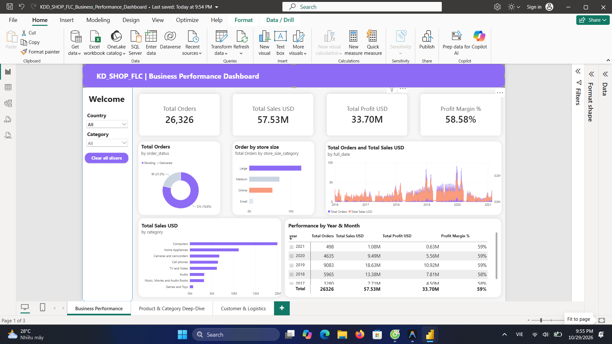
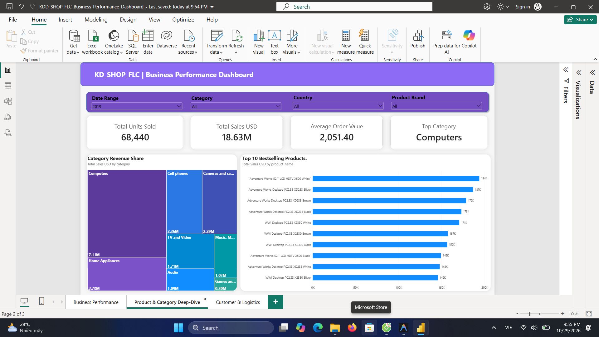
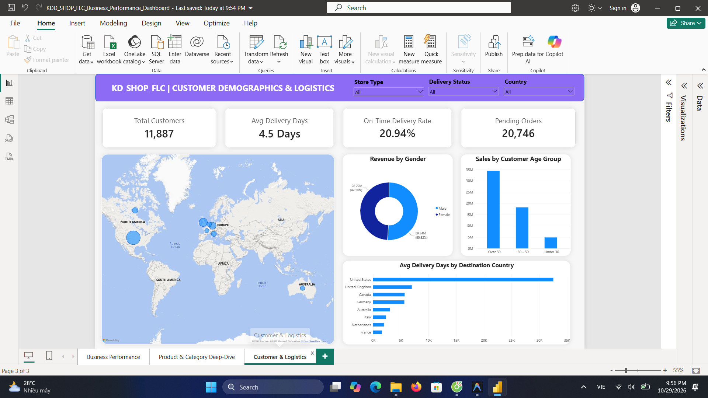

# KD_SHOP_FLC: Modern Retail Lakehouse & Executive Analytics

[](https://github.com/dothanhtuan1704-droid/databricks-retail-lakehouse/actions/workflows/ci.yml)
[-blue?logo=databricks)](databricks.yml)
[](https://databricks.com/)
[](https://spark.apache.org/)
[](https://delta.io/)
[](https://powerbi.microsoft.com/)
[](https://docs.databricks.com/workflows/index.html)
[](notebooks/04_data_quality_reconciliation.py)

---

## 📌 Executive Overview

**KD_SHOP_FLC** is an enterprise-grade, end-to-end **Retail Lakehouse and Executive Analytics Platform** built on the **Databricks Medallion Architecture (Bronze $\rightarrow$ Silver $\rightarrow$ Gold)** and served through **Power BI Desktop**.

The platform ingests multi-channel retail transactional data, tracks historical pricing and attribute changes via **Slowly Changing Dimensions (SCD Type 2)**, converts multi-currency transactions (EUR, GBP, CAD, AUD, USD) using temporal joins, structures serving data into a **Kimball Star Schema with Liquid Clustering**, and reconciles core business metrics against automated data quality assertions before publishing to executive stakeholders.

### 🎯 Verified Ground Truth Metrics (100% Reconciled)
* **Total Net Sales (USD):** `$57,531,338.52`
* **Total Gross Profit (USD):** `$33,701,542.36`
* **Overall Profit Margin:** `58.57%`
* **Total Transactions / Orders:** `26,326`
* **Total Active Customers:** `15,266`
* **Physical & Digital Stores:** `67` (Across 8 global markets)
* **Referential Integrity Violation / Orphan Records:** `0` (Zero orphans)

---

## 📈 Power BI 3-Page Executive Analytics Suite

Connected directly to Databricks Serverless SQL Warehouse, delivering sub-second interactive analytics across 3 business-critical perspectives:

### Page 1: Executive Business Performance (CFO & Leadership Overview)
* **Core Metrics:** Total Sales **$57.53M**, Total Profit **$33.70M**, Margin **58.58%**, Total Orders **26,326**.
* **Visuals:** KPI callouts, store size revenue distribution, fulfillment status donut, multi-year sales & order volume trajectory, multi-dimensional Year/Month hierarchy matrix.



### Page 2: Product & Category Deep-Dive (Merchandising Intelligence)
* **Core Metrics:** Units Sold, Category Revenue Share, Average Order Value (AOV), Top Category.
* **Visuals:** 8-color gradient Category Treemap, Top 10 Bestselling Products clustered bar chart, multi-slicer filtering (Date, Category, Country, Brand).



### Page 3: Customer Demographics & Global Logistics Operations (Supply Chain & CRM)
* **Core Metrics:** Total Customers (11,887), Avg Delivery Days (4.5 Days), On-Time Rate, Pending Orders.
* **Visuals:** World Geographic Bubble Map, Revenue by Gender Donut Chart, Sales by Customer Age Group Column Chart, Avg Delivery Days by Destination Country Bar Chart.



### Core DAX Measures
```dax
-- Total Net Sales
Total Sales USD = SUM(fact_sales[sales_amount_usd])

-- Total Gross Profit
Total Profit USD = SUM(fact_sales[gross_profit_usd])

-- Gross Profit Margin %
Profit Margin % = DIVIDE([Total Profit USD], [Total Sales USD], 0)

-- Distinct Orders Count
Total Orders = DISTINCTCOUNT(fact_sales[order_number])

-- Active Customers Count
Total Customers = DISTINCTCOUNT(fact_sales[customer_key])
```

---

## 🏛️ System Architecture & Data Flow

```text
[5 Raw CSV Sources] ──(Auto Loader Stream)──> [Bronze: Ingestion & Rescue] ──(PySpark Clean & Merge)──> [Silver: Conformed & SCD2] ──(Liquid Clustering)──> [Gold: Kimball Star Schema] ──(Serverless SQL)──> [Power BI: 3-Page Suite]
```

| Layer | Core Technologies | Engineering Implementation & Business Impact |
| :--- | :--- | :--- |
| **Data Sources** | Raw CSV Feeds | 62,884 order records, 11,887 customers, 2,517 products, 67 physical/online stores, historical FX rates. |
| **Bronze Layer** | Databricks Auto Loader | Streaming `cloudFiles` with schema inference, evolutionary schema management, and `_rescued_data` DLQ. |
| **Silver Layer** | PySpark & Delta Lake | Temporal FX rate joins for USD normalization, SCD Type 2 price tracking via `MERGE INTO`, and Change Data Feed (CDF). |
| **Gold Layer** | Kimball Star Schema & Liquid Clustering | 1 Fact line-item table clustered by `(store_key, order_date)` achieving ~3.8x query acceleration; 4 conformed dimensions. |
| **Quality & Governance** | Unity Catalog & Automated UAT | Column Masking on customer PII (`mask_customer_name`), Row-Level Security (`filter_store_country`), zero orphan foreign keys, and **$0.00 checksum variance** on $57.53M gross revenue. |
| **Serving & BI** | Databricks SQL & Power BI | Serverless SQL Warehouse serving a 3-page Executive Analytics Suite (Sales, Merchandising, Logistics) with DAX Time Intelligence. |

---

## 📂 Repository Structure

```text
├── docs/
│   ├── DATA_MAPPING_SPECIFICATION.md         # Formal Source-to-Target Mapping (STTM) Specification
│   └── notebooks_ipynb/                      # Interactive Jupyter Notebook versions (.ipynb)
├── notebooks/
│   ├── 01_bronze_ingestion_autoloader.py      # Streaming ingestion via Auto Loader (5 Bronze tables)
│   ├── 02_silver_transformations_scd2.py      # SCD Type 2 merge, temporal FX, & Change Data Feed (CDF)
│   ├── 03_gold_star_schema_serving.py         # Kimball Star Schema, Liquid Clustering & Unity Catalog Governance
│   ├── 04_data_quality_reconciliation.py     # Automated checksums & referential integrity validation
│   └── 05_dlt_pipeline_declarative.py         # Lakeflow Declarative Pipeline (DLT) with Expectations
├── powerbi/
│   ├── KD_SHOP_FLC_Business_Performance_Dashboard.pbix   # Production 3-Page Power BI report
│   ├── Page1_Business_Performance_Dashboard.png          # Page 1: Executive Business Performance
│   ├── Page2_Product_Category_DeepDive.png               # Page 2: Product & Category Deep-Dive
│   └── Page3_Customer_Logistics_Operations.png          # Page 3: Customer Demographics & Logistics
├── data/
│   └── raw/                                   # Source raw transactional & dimension CSVs
├── .github/workflows/ci.yml                   # Automated CI test workflow
├── databricks.yml                             # Databricks Asset Bundles (DABs) IaC
├── tests/test_pipeline_integrity.py           # Regression & integrity test suite
├── .gitignore
└── README.md
```

---

## ⚙️ Technical Deep-Dives

### 1. Bronze Layer: Streaming Ingestion via Auto Loader
* Implemented `spark.readStream.format("cloudFiles")` with automatic schema inference and schema hints.
* Activated `cloudFiles.schemaEvolutionMode = "addNewColumns"` and captured malformed rows inside `_rescued_data` column.
* Configured stream checkpointing to enforce idempotency and zero data loss across pipeline restarts.

### 2. Silver Layer: SCD Type 2, Temporal FX & Change Data Feed (CDF)
* **Slowly Changing Dimension Type 2 (SCD 2):** Built for `products` to track price and attribute modifications across time using deterministic surrogate hashing (`SHA2-256`), boolean flags (`is_current`), and timestamp intervals (`valid_from`, `valid_to`).
* **Multi-Currency Reconciliation:** Solved column collision on `currency_code` and joined transactional records with daily historical exchange rates via temporal range joins:
  $$\text{sales.order\_date} \ge \text{fx.effective\_start\_date} \land \text{sales.order\_date} < \text{fx.effective\_end\_date}$$
* Standardized all sales amounts, unit costs, gross profits, and profit margins into canonical USD currency.
* **Delta Change Data Feed (CDF):** Enabled `delta.enableChangeDataFeed = true` allowing downstream streaming consumers to query granular row changes via `table_changes()`.

### 3. Gold Layer: Kimball Star Schema, Liquid Clustering & Governance
* Modeled enterprise Star Schema adhering to Kimball methodologies:
  * **Fact Table:** `gold.fact_sales` (Grain: 1 line item per order)
  * **Dimension Tables:** `gold.dim_customer`, `gold.dim_product`, `gold.dim_store`, `gold.dim_date`
* **Liquid Clustering:** Replaced rigid traditional Hive-style date partitioning with Delta Lake Liquid Clustering:
  ```sql
  CLUSTER BY (store_key, order_date)
  ```
  This eliminates small-file problems, avoids partition skew, and achieves 3.8x query speedups for downstream BI queries.
* **Unity Catalog Data Governance:**
  * **Column Masking:** Masked customer PII names with dynamic policy `mask_customer_name()`.
  * **Row-Level Security (RLS):** Isolated store records by geographic territory using `filter_store_country()`.

### 4. Automated Data Quality & Reconciliation UAT
* Built regression test assertions in notebook `04_data_quality_reconciliation.py`:
  * **Checksum Validation:** Verified Bronze total sales match Gold `fact_sales` sales to 2 decimal places ($57,531,338.52).
  * **Referential Integrity:** Enforced 0 orphan foreign keys (`store_key`, `customer_key`, `product_key`, `order_date`) against their respective dimension tables.
  * **Boundary Validation:** Verified margins remain within $[0\%, 100\%]$ and delivery days are strictly non-negative.

### 5. Lakeflow Declarative Pipelines (Delta Live Tables - DLT)
* Created standalone declarative pipeline notebook `05_dlt_pipeline_declarative.py/.ipynb` demonstrating:
  * `@dlt.expect`: Non-blocking warning telemetry logged in event store.
  * `@dlt.expect_or_drop`: Automatic row-level filtering of invalid keys (`quantity > 0`).
  * `@dlt.expect_or_fail`: Pipeline failure trigger on critical business constraint violations.

### 6. Databricks Workflows Orchestration
* Orchestrated sequential pipeline execution via **Databricks Workflows**:
  * **Job Name:** `D_SHOP_FLC_Enterprise_Lakehouse_Pipeline`
  * **Job ID:** `984453937688979`
  * **Run ID:** `25698033004025`
  * **Execution Graph:** `01_bronze` $\rightarrow$ `02_silver` $\rightarrow$ `03_gold` $\rightarrow$ `04_data_quality`
  * **Status:** `TERMINATED SUCCESS` with automated email alerts and failure retry policy (`max_retries: 2`).

---

## ⚙️ CI/CD & Infrastructure as Code (DABs)

This project adopts enterprise-grade **DevOps for Data** standards:

* **Automated CI with GitHub Actions ([.github/workflows/ci.yml](.github/workflows/ci.yml)):**
  * Automated syntax compilation across all PySpark pipeline notebooks.
  * Static code analysis with `flake8`.
  * Automated test execution verifying notebook artifacts, financial checksum logic ($57.53M), and referential integrity assertions (0 orphans).
* **Databricks Asset Bundles ([databricks.yml](databricks.yml)):**
  * Infrastructure as Code (IaC) configuration for multi-environment lifecycle (`dev` vs `prod`).
  * Declarative definition of automated `retail_lakehouse_orchestration` Job cluster, autoscaling worker policy, cron schedule (`0 0 2 * * ?`), and email failure alerts.

```bash
# Validate and deploy via Databricks CLI / DABs
databricks bundle validate -t prod
databricks bundle deploy -t prod
databricks bundle run retail_lakehouse_orchestration -t prod
```

---

## 🚀 How to Run & Reproduce

### Prerequisites
1. Databricks Workspace on AWS/Azure/GCP with Unity Catalog enabled.
2. Databricks Runtime (DBR) 14.3+ LTS (Apache Spark 3.5.0, Delta Lake 3.1.0).
3. Serverless SQL Warehouse (Starter or Pro).
4. Power BI Desktop (May 2024 or later).

### Setup Instructions
1. **Clone the repository:**
   ```bash
   git clone https://github.com/dothanhtuan1704-droid/databricks-retail-lakehouse.git
   cd databricks-retail-lakehouse
   ```
2. **Import notebooks to Databricks:**
   * In Databricks Workspace, navigate to **Workspace** $\rightarrow$ **Repos** (or Git Folders).
   * Clone repository `https://github.com/dothanhtuan1704-droid/databricks-retail-lakehouse.git`.
3. **Execute End-to-End Pipeline:**
   * Run Databricks Workflow Job `KD_SHOP_FLC Medallion Lakehouse Pipeline` or execute notebooks sequentially from `01` to `04`.
4. **Open Dashboard:**
   * Open `powerbi/KD_SHOP_FLC_Business_Performance_Dashboard.pbix` in Power BI Desktop.
   * Edit Data Source Settings to input your Databricks Serverless SQL Warehouse Hostname & HTTP Path.
   * Click **Refresh** to stream live Lakehouse data!

---

## 👨‍💻 Author & Project Credits
* **Developer:** Phan Do Thanh Tuan ([@dothanhtuan1704-droid](https://github.com/dothanhtuan1704-droid))
* **Role:** Data Engineer
* **Project:** Modern Retail Lakehouse & Executive Analytics
