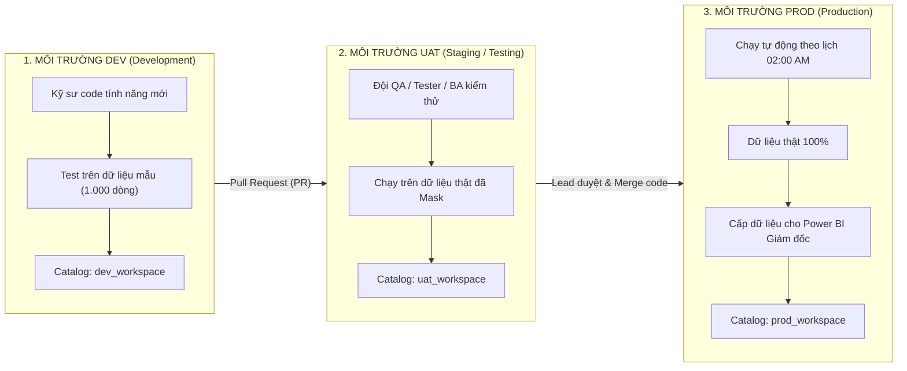

# TUẦN 3 - SESSION 3.5: CI/CD & QUẢN TRỊ MÔI TRƯỜNG DỮ LIỆU
## (Dev / UAT / Prod, Databricks Asset Bundles - DABs, Terraform, Git CI/CD)

---

## 1. BỨC TRANH LỚN: TẠI SAO DATA ENGINEER CẦN CI/CD?

### 1.1. Thực tế nguy hiểm của cách làm "nghiệp dư" (Manual deployment)
Trong môi trường học tập hoặc làm bài tập cá nhân, bạn thường:
1. Mở giao diện Databricks web lên.
2. Tạo Notebook, gõ code và bấm "Run".
3. Khi xong việc thì để nguyên đó hoặc export ra file `.dbc` / `.py` gửi qua Zalo/Email.

> ⚠️ **Hậu quả thảm khốc trong doanh nghiệp lớn (như FPT Software / QAI):**
> - **Lẫn lộn môi trường:** Kỹ sư lỡ tay chạy nhầm câu lệnh `DROP TABLE` trên database thật của khách hàng (Production) thay vì database thử nghiệm (Dev).
> - **Lệch phiên bản (Version drift):** Không ai biết Notebook trên Databricks hiện tại là phiên bản nào, ai sửa dòng code nào, sửa vì lý do gì.
> - **Không thể khôi phục (No rollback):** Khi pipeline bị lỗi sập, không có cách nào quay trở về phiên bản ổn định ngày hôm qua trong 1 phút.

---

### 1.2. Chuẩn mực doanh nghiệp: Mô hình 3 Môi trường (Dev - UAT - Prod)



| Tiêu chí | DEV (Phát triển) | UAT / STAGING (Kiểm thử) | PROD (Vận hành thật) |
| :--- | :--- | :--- | :--- |
| **Người sử dụng** | Các kỹ sư Data Engineer trong team | Đội Kiểm toán, BA, Tester, Khách hàng | Hệ thống tự động, Ban Giám đốc |
| **Tập dữ liệu** | Dữ liệu mẫu (Sample/Mock data), vài ngàn dòng | Dữ liệu đầy đủ (Full dataset) nhưng ẩn thông tin cá nhân | Toàn bộ dữ liệu doanh nghiệp thật |
| **Quyền truy cập** | Toàn quyền Read/Write/Drop | Chỉ đọc (Read-only) + Test chạy pipeline | **Không ai được sửa trực tiếp**, chỉ robot CI/CD mới được deploy |
| **Compute** | All-Purpose Cluster (để gõ lệnh debug) | Single-node / Job Cluster thử nghiệm | **Job Cluster tự động bật/tắt** để tiết kiệm chi phí |

---

## 2. INFRASTRUCTURE AS CODE (IaC) & TERRAFORM

### 2.1. Khái niệm IaC
- **Truyền thống:** Đăng nhập vào AWS/Azure/Databricks, dùng chuột click: Tạo VPC $\rightarrow$ Tạo S3 bucket $\rightarrow$ Tạo Databricks Workspace $\rightarrow$ Tạo Unity Catalog Metastore. (Mất 3 ngày, rất dễ click nhầm).
- **IaC (Hạ tầng dưới dạng mã):** Toàn bộ máy chủ, mạng, phân quyền được khai báo trong các file văn bản code. Chạy 1 dòng lệnh là toàn bộ hệ sinh thái tự động mọc lên trong 10 phút!

### 2.2. Terraform là gì?
- **Terraform** (của HashiCorp) là công cụ IaC số 1 thế giới.
- Sử dụng ngôn ngữ khai báo **HCL (HashiCorp Configuration Language)**.
- **Ví dụ file Terraform tạo Unity Catalog Schema trên Databricks:**
  ```hcl
  resource "databricks_catalog" "sandbox" {
    name         = "sandbox"
    comment      = "Catalog danh cho moi truong Dev thu nghiem"
    storage_root = "s3://my-company-lakehouse-bucket/sandbox"
  }

  resource "databricks_schema" "gold" {
    catalog_name = databricks_catalog.sandbox.id
    name         = "gold"
    comment      = "Chua cac bang Fact va Dim phuc vu Power BI"
  }
  ```

---

## 3. VŨ KHÍ CỦA DATABRICKS: DATABRICKS ASSET BUNDLES (DABs)

### 3.1. DABs là gì?
- **Databricks Asset Bundles (DABs)** là tiêu chuẩn quản lý mã nguồn và triển khai CI/CD hiện đại nhất do Databricks phát triển (thay thế cho cách dùng Databricks CLI truyền thống).
- DABs cho phép bạn đóng gói: Toàn bộ Notebooks, file Python thư viện, cấu hình Databricks Workflows (Job, Task, Dependency, Schedule) vào trong **1 thư mục dự án duy nhất** được quản lý bởi Git.

### 3.2. Cấu trúc thư mục của một dự án DABs chuẩn:
```text
d_shop_flc_bundle/
├── databricks.yml              # File cấu hình trung tâm định nghĩa targets & variables
├── resources/
│   └── daily_sales_job.yml     # Định nghĩa Workflow Job (Bronze -> Silver -> Gold)
├── src/
│   ├── 01_ingest_bronze.py     # Code PySpark Auto Loader
│   ├── 02_clean_silver.py      # Code PySpark làm sạch & deduplication
│   └── 03_load_gold.py         # Code PySpark tạo Fact & Dim
└── tests/
    └── test_transformations.py # Unit tests kiểm tra logic hàm
```

### 3.3. Chi tiết file cấu hình trung tâm `databricks.yml`:
```yaml
bundle:
  name: d_shop_flc_lakehouse

# Khai báo các môi trường triển khai (Targets)
targets:
  # Môi trường Dev của cá nhân kỹ sư
  dev:
    mode: development
    default: true
    workspace:
      host: https://dbc-dev.cloud.databricks.com
    variables:
      catalog_name: workspace_dev

  # Môi trường Prod chạy thật cho khách hàng
  prod:
    mode: production
    workspace:
      host: https://dbc-f1a30aac-c96c.cloud.databricks.com
    variables:
      catalog_name: workspace
    run_as:
      service_principal_name: 12345678-abcd-ef01-2345-6789abcdef01
```

### 3.4. Định nghĩa Job tự động trong `resources/daily_sales_job.yml`:
```yaml
resources:
  jobs:
    d_shop_flc_master_pipeline:
      name: "[${bundle.target}] D_SHOP_FLC Master Pipeline"
      
      # Hẹn giờ chạy tự động lúc 02:00 sáng
      schedule:
        quartz_cron_expression: "0 0 2 * * ?"
        timezone_id: "Asia/Ho_Chi_Minh"

      # Cảnh báo qua email khi có lỗi
      email_notifications:
        on_failure:
          - "de_team@fpt.com"

      tasks:
        # Task 1: Ingest Bronze
        - task_key: "ingest_bronze"
          notebook_task:
            notebook_path: "../src/01_ingest_bronze.py"
            base_parameters:
              target_catalog: ${var.catalog_name}

        # Task 2: Transform Silver (chạy sau Task 1)
        - task_key: "transform_silver"
          depends_on:
            - task_key: "ingest_bronze"
          notebook_task:
            notebook_path: "../src/02_clean_silver.py"
            base_parameters:
              target_catalog: ${var.catalog_name}

        # Task 3: Load Gold (chạy sau Task 2)
        - task_key: "load_gold"
          depends_on:
            - task_key: "transform_silver"
          notebook_task:
            notebook_path: "../src/03_load_gold.py"
            base_parameters:
              target_catalog: ${var.catalog_name}
```

### 3.5. Bộ 4 câu lệnh DABs "nằm lòng" của Kỹ sư Data:
1. `databricks bundle validate`: Kiểm tra file YAML có bị sai cú pháp, thụt lề sai hay thiếu biến không.
2. `databricks bundle deploy -t dev`: Đẩy toàn bộ code và dựng Job lên môi trường Dev để chạy thử.
3. `databricks bundle run -t dev d_shop_flc_master_pipeline`: Kích hoạt chạy ngay pipeline trên Dev để xem kết quả.
4. `databricks bundle deploy -t prod`: Đẩy chính thức lên môi trường Production!

---

## 4. QUY TRÌNH CI/CD TỰ ĐỘNG HÓA VỚI GITHUB ACTIONS

### 4.1. Sơ đồ luồng CI/CD trong thực tế dự án:

```text
[Kỹ sư viết code trên máy tính]
            │
            ▼ (git push origin feature/fix-scd2)
   [GitHub Repository]
            │
            ▼ (Tạo Pull Request vào nhánh `main`)
┌────────────────────────────────────────────────────────┐
│  BƯỚC 1: CI (Continuous Integration) - TỰ ĐỘNG CHẠY   │
│  - Kiểm tra chuẩn code: flake8, black                  │
│  - Chạy Unit Test: pytest test_transformations.py      │
│  - Kiểm tra cú pháp Bundle: databricks bundle validate │
└────────────────────────────────────────────────────────┘
            │
            ▼ (Nếu CI thành công 100% -> Tech Lead Lvn review & Bấm MERGE)
┌────────────────────────────────────────────────────────┐
│  BƯỚC 2: CD (Continuous Deployment) - TỰ ĐỘNG CHẠY    │
│  - Kết nối Databricks Prod bằng Service Principal      │
│  - Chạy lệnh: databricks bundle deploy -t prod         │
│  - Cập nhật Workflow Jobs, notebooks, lịch chạy 02:00  │
└────────────────────────────────────────────────────────┘
```

### 4.2. File cấu hình GitHub Actions thực tế (`.github/workflows/deploy.yml`):
```yaml
name: Databricks CI/CD Pipeline

on:
  push:
    branches: [ main ]
  pull_request:
    branches: [ main ]

jobs:
  # Giai đoạn 1: Kiểm tra chất lượng (CI)
  test-and-validate:
    runs-on: ubuntu-latest
    steps:
      - name: Checkout Code
        uses: actions/checkout@v3

      - name: Set up Python
        uses: actions/setup-python@v4
        with:
          python-version: '3.10'

      - name: Install dependencies
        run: |
          pip install pytest flake8 databricks-cli

      - name: Run Linting (Check cú pháp)
        run: |
          flake8 src/ --max-line-length=120

      - name: Run Unit Tests
        run: |
          pytest tests/

      - name: Validate Databricks Bundle
        run: |
          databricks bundle validate
        env:
          DATABRICKS_HOST: ${{ secrets.DATABRICKS_HOST }}
          DATABRICKS_TOKEN: ${{ secrets.DATABRICKS_TOKEN }}

  # Giai đoạn 2: Triển khai lên Production (CD)
  deploy-to-prod:
    needs: test-and-validate
    if: github.ref == 'refs/heads/main' && github.event_name == 'push'
    runs-on: ubuntu-latest
    steps:
      - name: Checkout Code
        uses: actions/checkout@v3

      - name: Install Databricks CLI
        run: |
          curl -fsSL https://raw.githubusercontent.com/databricks/setup-cli/main/install.sh | sh

      - name: Deploy Bundle to Production
        run: |
          databricks bundle deploy -t prod
        env:
          DATABRICKS_HOST: ${{ secrets.DATABRICKS_PROD_HOST }}
          DATABRICKS_TOKEN: ${{ secrets.DATABRICKS_PROD_TOKEN }}
```

---

## 5. BỘ 5 CÂU HỎI PHỎNG VẤN "SÁT THỦ" VỀ CI/CD & MÔI TRƯỜNG

### Câu hỏi 1: Làm sao em truyền được tên Catalog khác nhau (ở Dev là `workspace_dev`, ở Prod là `workspace_prod`) mà không phải sửa code thủ công?
> **Trả lời:**
> Em sử dụng **Tham số hóa (Parameterization)** qua Databricks Asset Bundles:
> - Trong file `databricks.yml`, em định nghĩa biến `catalog_name` ứng với từng target (`dev` hoặc `prod`).
> - Trong Databricks Workflows, biến này được truyền vào làm `base_parameters` cho từng Task.
> - Trong code PySpark, em dùng `dbutils.widgets.get("target_catalog")` để đọc tên catalog. Khi deploy sang môi trường nào, code sẽ tự động ghi vào catalog của môi trường đó mà không cần sửa 1 dòng code logic nào.

---

### Câu hỏi 2: Sự khác nhau giữa Terraform và Databricks Asset Bundles (DABs)? Khi nào dùng cái nào?
> **Trả lời:**
> - **Terraform (Tầng Hạ tầng - Infrastructure level):** Dùng để khởi tạo tài nguyên đám mây gốc (tạo S3/ADLS bucket, tạo Databricks Workspace, tạo Metastore Unity Catalog, cấu hình mạng VPC). Thường do đội Platform/DevOps phụ trách 1 lần ban đầu.
> - **DABs (Tầng Ứng dụng Dữ liệu - Application level):** Dành riêng cho đội Data Engineer để quản lý mã nguồn Notebook, code PySpark, cấu hình Workflows Job và triển khai lặp đi lặp lại hàng ngày theo chu kỳ phát triển phần mềm.

---

### Câu hỏi 3: Làm thế nào để quản lý các thông tin nhạy cảm (Token, Database Password) trong CI/CD để không bị lộ lên Git?
> **Trả lời:**
> Tuyệt đối **không bao giờ hardcode token/mật khẩu trong code hay file YAML**. Em quản lý qua 2 lớp bảo mật:
> 1. Trên GitHub: Lưu vào **GitHub Encrypted Secrets** (ví dụ `${{ secrets.DATABRICKS_TOKEN }}`).
> 2. Trên Databricks: Sử dụng **Databricks Secret Scopes** (tích hợp với AWS Secrets Manager hoặc Azure Key Vault). Trong code PySpark chỉ gọi hàm `dbutils.secrets.get(scope = "my_scope", key = "db_password")`.

---

### Câu hỏi 4: Nếu một bản deploy lên Production bị lỗi nghiêm trọng, em sẽ xử lý Rollback như thế nào?
> **Trả lời:**
> Em thực hiện Rollback qua 2 bước nhanh chóng:
> 1. **Rollback mã nguồn (Code Rollback):** Trên GitHub, tạo lệnh `git revert` đưa nhánh `main` về commit ổn định trước đó. Pipeline CD sẽ tự động deploy lại phiên bản cũ lên Databricks trong vòng 2 phút.
> 2. **Rollback dữ liệu (Data Rollback):** Nhờ cơ chế **Time Travel của Delta Lake**, em có thể khôi phục bảng về trạng thái trước khi bị lỗi bằng câu lệnh:
>    ```sql
>    RESTORE TABLE workspace.gold.fact_sales TO VERSION AS OF 15;
>    ```

---

### Câu hỏi 5: Trong môi trường Production, job nên chạy dưới danh nghĩa (Identity) của ai? Tài khoản cá nhân của em hay Service Principal?
> **Trả lời:**
> Bắt buộc phải chạy bằng **Service Principal (SP)**. 
> Vì nếu cấu hình chạy bằng tài khoản cá nhân của kỹ sư, khi kỹ sư đó nghỉ việc hoặc đổi mật khẩu, toàn bộ pipeline Production của công ty sẽ bị ngưng trệ ngay lập tức. Service Principal là một danh tính máy (Non-human identity), có token riêng, độc lập với nhân sự và được cấp quyền tối thiểu (Least Privilege).
