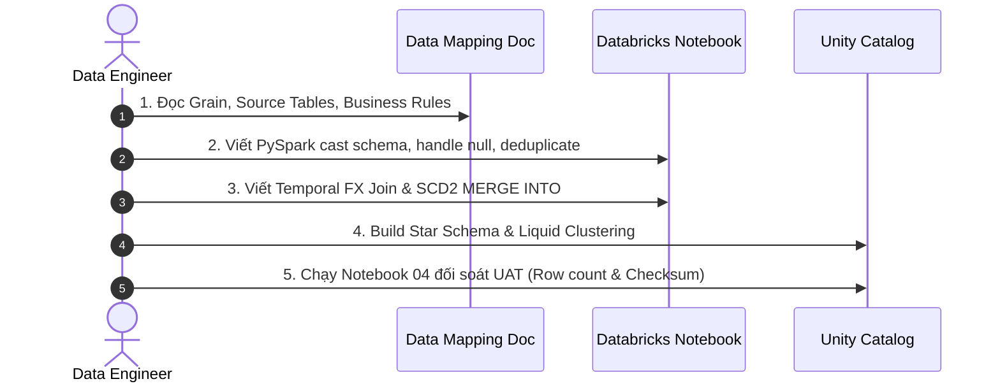

# DATA MAPPING SPECIFICATION (SOURCE-TO-TARGET MAPPING - STTM)
## Project: KD_SHOP_FLC Modern Retail Lakehouse & Executive Analytics
**Author:** Data Engineering Team  
**Target Environment:** Databricks Unity Catalog (`workspace.bronze`, `workspace.silver`, `workspace.gold`)  
**Serving Layer:** Power BI Desktop (Executive Semantic Model)  

---

### 1. KIẾN TRÚC TỔNG THỂ & QUY TRÌNH XỬ LÝ (PIPELINE ARCHITECTURE)

```
[Raw Files / POS / ERP] 
       │ (Auto Loader cloudFiles)
       ▼
[workspace.bronze]  ─── Ingestion thô nguyên bản, lưu trữ schema evolution & _rescued_data
       │ (PySpark Clean, Temporal FX Join, SCD Type 2 MERGE)
       ▼
[workspace.silver]  ─── Dữ liệu chuẩn hóa, khử trùng lặp, quy đổi USD theo tỷ giá ngày
       │ (Kimball Star Schema & Liquid Clustering)
       ▼
[workspace.gold]    ─── fact_sales, conformed dimensions, agg_daily_store_sales
       │ (Databricks SQL Warehouse Connector)
       ▼
[Power BI Dashboard]─── Semantic Model, DAX Measures, 3 trang Executive Analytics
```

---

### 2. BẢNG ĐẶC TẢ CHI TIẾT SOURCE-TO-TARGET MAPPING (STTM)

#### 2.1. Ingestion: Bronze $\rightarrow$ Silver Customers (`workspace.silver.silver_customers`)
* **Nguồn:** `workspace.bronze.bronze_customers` (Landing path: `/Volumes/workspace/bronze/landing_zone/customers/`)
* **Đích:** `workspace.silver.silver_customers`
* **Grain (Mức độ hạt):** 1 dòng tương ứng với 1 khách hàng duy nhất (`customer_key`).

| Source Column | Source Type | Target Column | Target Type | Business Rule / Transformation Logic |
| :--- | :--- | :--- | :--- | :--- |
| `CustomerKey` | STRING/INT | `customer_key` | INT | Primary Key. Ép kiểu `cast('integer')`, filter loại bỏ giá trị NULL hoặc `<= 0`. |
| `Name` | STRING | `name` | STRING | Trim khoảng trắng thừa (`F.trim()`), giữ nguyên định dạng tên đầy đủ. |
| `Gender` | STRING | `gender` | STRING | Chuẩn hóa giới tính: `'M'` (Male), `'F'` (Female). |
| `Birthday` | STRING | `birthday` | DATE | Chuyển đổi định dạng ngày: `F.to_date(col, 'M/d/yyyy')`. |
| `City` | STRING | `city` | STRING | Trim khoảng trắng, chuẩn hóa tên thành phố. |
| `State Code` | STRING | `state_code` | STRING | Mã bang (ví dụ: `CA`, `TX`, `NY`). Uppercase. |
| `State` | STRING | `state` | STRING | Tên bang đầy đủ. |
| `Zip Code` | STRING | `zip_code` | STRING | Mã bưu chính (giữ dạng string để không mất số 0 ở đầu). |
| `Country` | STRING | `country` | STRING | Quốc gia cư trú của khách hàng. |
| `Continent` | STRING | `continent` | STRING | Châu lục (North America, Europe, Australia,...). |
| *(System)* | - | `_updated_at` | TIMESTAMP | `F.current_timestamp()` để lưu vết thời gian ghi dữ liệu. |
| **Deduplication Rule** | - | - | - | `dropDuplicates(['customer_key'])`. |

---

#### 2.2. Ingestion: Bronze $\rightarrow$ Silver Stores (`workspace.silver.silver_stores`)
* **Nguồn:** `workspace.bronze.bronze_stores`
* **Đích:** `workspace.silver.silver_stores`
* **Grain:** 1 dòng tương ứng với 1 cửa hàng (`store_key`).

| Source Column | Source Type | Target Column | Target Type | Business Rule / Transformation Logic |
| :--- | :--- | :--- | :--- | :--- |
| `StoreKey` | STRING/INT | `store_key` | INT | Primary Key. `store_key = 0` là cửa hàng Online (E-Commerce). |
| `Country` | STRING | `country` | STRING | Quốc gia đặt cửa hàng (Online store ghi nhận `Online`). |
| `State` | STRING | `state` | STRING | Bang/Tỉnh đặt cửa hàng. |
| `Square Meters`| STRING/INT | `square_meters` | INT | Diện tích sàn. Nếu NULL hoặc Online store thì điền mặc định = `0`. |
| `Open Date` | STRING | `open_date` | DATE | Chuyển đổi ngày khai trương: `F.to_date(col, 'M/d/yyyy')`. |
| *(Derived)* | - | `store_size_category`| STRING | **Logic phân loại quy mô cửa hàng:**<br>• `square_meters == 0`: `'Online Store'`<br>• `square_meters <= 500`: `'Small (< 500m²)'`<br>• `square_meters <= 1000`: `'Medium (500 - 1000m²)'`<br>• `square_meters > 1000`: `'Large (> 1000m²)'` |
| *(System)* | - | `_updated_at` | TIMESTAMP | `F.current_timestamp()`. |

---

#### 2.3. Ingestion: Bronze $\rightarrow$ Silver Products SCD Type 2 (`workspace.silver.silver_products_scd2`)
* **Nguồn:** `workspace.bronze.bronze_products`
* **Đích:** `workspace.silver.silver_products_scd2`
* **Chiến lược:** **Slowly Changing Dimension Type 2 (SCD2)** theo dõi lịch sử thay đổi giá bán (`unit_price_usd`) và giá vốn (`unit_cost_usd`).
* **Grain:** 1 dòng tương ứng với một phiên bản giá của sản phẩm (`product_sk`).

| Source Column | Source Type | Target Column | Target Type | Business Rule / Transformation Logic |
| :--- | :--- | :--- | :--- | :--- |
| `ProductKey` | STRING/INT | `product_key` | INT | Natural Business Key của sản phẩm. |
| `Product Name`| STRING | `product_name` | STRING | Tên thương mại sản phẩm. |
| `Brand` | STRING | `brand` | STRING | Thương hiệu sản xuất. |
| `Color` | STRING | `color` | STRING | Màu sắc sản phẩm. |
| `Unit Cost USD`| STRING | `unit_cost_usd` | DECIMAL(12,2)| Ép kiểu tiền tệ `cast('decimal(12,2)')`. |
| `Unit Price USD`| STRING| `unit_price_usd`| DECIMAL(12,2)| Ép kiểu tiền tệ `cast('decimal(12,2)')`. |
| `Subcategory` | STRING | `subcategory` | STRING | Nhóm sản phẩm con (Laptops, Cameras, Smart Phones,...). |
| `Category` | STRING | `category` | STRING | Nhóm ngành hàng lớn (Computers, Audio, Cameras,...). |
| *(Surrogate)* | - | `product_sk` | STRING | **Khóa thay thế (Surrogate Key):** Tạo bằng SHA-256 hash:<br>`sha2(concat_ws('\|\|', product_key, unit_cost_usd, unit_price_usd, start_date), 256)`. |
| *(SCD2 Tracking)*| - | `start_date` | DATE | Ngày bắt đầu có hiệu lực của mức giá này. |
| *(SCD2 Tracking)*| - | `end_date` | DATE | Ngày hết hiệu lực (NULL nếu đang là bản ghi hiện hành). |
| *(SCD2 Tracking)*| - | `is_current` | BOOLEAN | `TRUE` nếu là mức giá hiện tại, `FALSE` nếu là mức giá lịch sử. |

---

#### 2.4. Ingestion: Bronze $\rightarrow$ Silver Sales (`workspace.silver.silver_sales`)
* **Nguồn:** `workspace.bronze.bronze_sales` kết hợp `workspace.silver.silver_exchange_rates`
* **Đích:** `workspace.silver.silver_sales`
* **Grain:** 1 dòng tương ứng với 1 chi tiết mặt hàng trong đơn (`order_number + line_item`).

| Source Column | Source Type | Target Column | Target Type | Business Rule / Transformation Logic |
| :--- | :--- | :--- | :--- | :--- |
| `Order Number` | STRING/INT | `order_number` | INT | Mã định danh đơn hàng (Composite PK). |
| `Line Item` | STRING/INT | `line_item` | INT | Số thứ tự mặt hàng trong đơn (Composite PK). |
| `Order Date` | STRING | `order_date` | DATE | Ngày đặt hàng (`yyyy-MM-dd`). |
| `Delivery Date`| STRING | `delivery_date` | DATE | Ngày giao hàng thực tế. Cho phép NULL nếu đơn chưa giao. |
| `CustomerKey` | INT | `customer_key` | INT | Khóa ngoại tham chiếu `silver_customers.customer_key`. |
| `StoreKey` | INT | `store_key` | INT | Khóa ngoại tham chiếu `silver_stores.store_key`. |
| `ProductKey` | INT | `product_key` | INT | Khóa ngoại tham chiếu `silver_products.product_key`. |
| `Quantity` | INT | `quantity` | INT | Số lượng mua (`quantity > 0`). |
| `Currency Code`| STRING | `currency_code` | STRING | Đơn vị tiền tệ gốc của giao dịch (USD, EUR, GBP, CAD, AUD). |
| *(Temporal Join)*| - | `exchange_rate` | DECIMAL(10,4)| **Temporal Rate Lookup:** Join với `silver_exchange_rates` theo điều kiện:<br>`currency_code == rate_currency AND order_date == rate_date`.<br>Nếu `currency_code == 'USD'` hoặc không có tỷ giá khớp, gán `effective_rate = 1.0`. |
| *(Calculation)* | - | `sales_amount_usd`| DECIMAL(12,2)| `round((quantity * unit_price_usd) / effective_rate, 2)`. |
| *(Calculation)* | - | `total_cost_usd` | DECIMAL(12,2)| `round((quantity * unit_cost_usd) / effective_rate, 2)`. |
| *(Calculation)* | - | `gross_profit_usd`| DECIMAL(12,2)| `round(sales_amount_usd - total_cost_usd, 2)`. |
| *(Performance)* | - | `delivery_days` | INT | `datediff(delivery_date, order_date)`. |
| *(Derived)* | - | `order_status` | STRING | `when(delivery_date.isNull(), 'Pending').otherwise('Delivered')`. |

---

### 3. CHUYỂN ĐỔI SILVER $\rightarrow$ GOLD STAR SCHEMA (`workspace.gold.*`)

```
               ┌────────────────────────┐
               │    gold.dim_date       │
               │  PK: date_key (Int)    │
               └───────────┬────────────┘
                           │ 1
                           │
                           │ N (order_date = full_date)
┌──────────────────────┐   │   ┌──────────────────────┐
│  gold.dim_customer   │   │   │   gold.dim_store     │
│  PK: customer_key    ├───┼───┤  PK: store_key       │
└──────────┬───────────┘   │   └──────────┬───────────┘
           │ 1             │              │ 1
           │               │              │
           │ N             ▼              │ N
         ┌─┴──────────────────────────────┴─┐
         │         gold.fact_sales          │
         │  PK: (order_number, line_item)   │
         │  FK: customer_key, store_key,    │
         │      product_key, order_date     │
         │  Cluster By: store_key, order_date
         └─┬────────────────────────────────┘
           │ N
           │
           │ 1
┌──────────┴───────────┐
│   gold.dim_product   │
│   PK: product_sk     │
│   BK: product_key    │
└──────────────────────┘
```

#### 3.1. Phân loại Khóa & Quan hệ trong Star Schema:
1. **`fact_sales` (Fact Table Chính):**
   * Grain: Atomic line-item transaction.
   * Clustered By: `(store_key, order_date)` via **Databricks Liquid Clustering**.
   * Số lượng dòng kiểm toán: **62,884 dòng**.
   * Doanh thu kiểm toán (Ground-Truth Checksum): **$57,531,338.52 USD** (Sai lệch: **$0.00**).
2. **`agg_daily_store_sales` (Bảng Aggregate phục vụ DirectQuery Power BI):**
   * Grain: `order_date + store_key + country + store_size_category`.
   * Số lượng bản ghi: ~1,500 dòng (giảm tải 97% I/O so với fact chi tiết, độ trễ truy vấn < 0.2s).

---

### 4. QUY TRÌNH DE ĐỌC DATA MAPPING ĐỂ VIẾT CODE PYSPARK

Khi nhận được tài liệu Data Mapping này, Data Engineer thực hiện theo 4 bước chuẩn chỉ:



1. **Bước 1 (Schema & Type Casting):** Định nghĩa schema chính xác, ép kiểu từ chuỗi text thô sang `INT`, `DECIMAL(12,2)`, `DATE`.
2. **Bước 2 (Data Cleansing & Deduplication):** Sử dụng `dropDuplicates` trên Business Key, xử lý các giá trị bất thường (`_rescued_data`).
3. **Bước 3 (Temporal Lookup & SCD2):** Join tỷ giá ngoại tệ theo ngày đặt hàng để triệt tiêu chênh lệch tỷ giá; áp dụng `MERGE INTO` để quản lý lịch sử giá.
4. **Bước 4 (Serving Optimization & Audit):** Áp dụng Liquid Clustering trên Fact và chạy script UAT Reconciliation tự động so sánh số liệu đầu vào với đầu ra.
